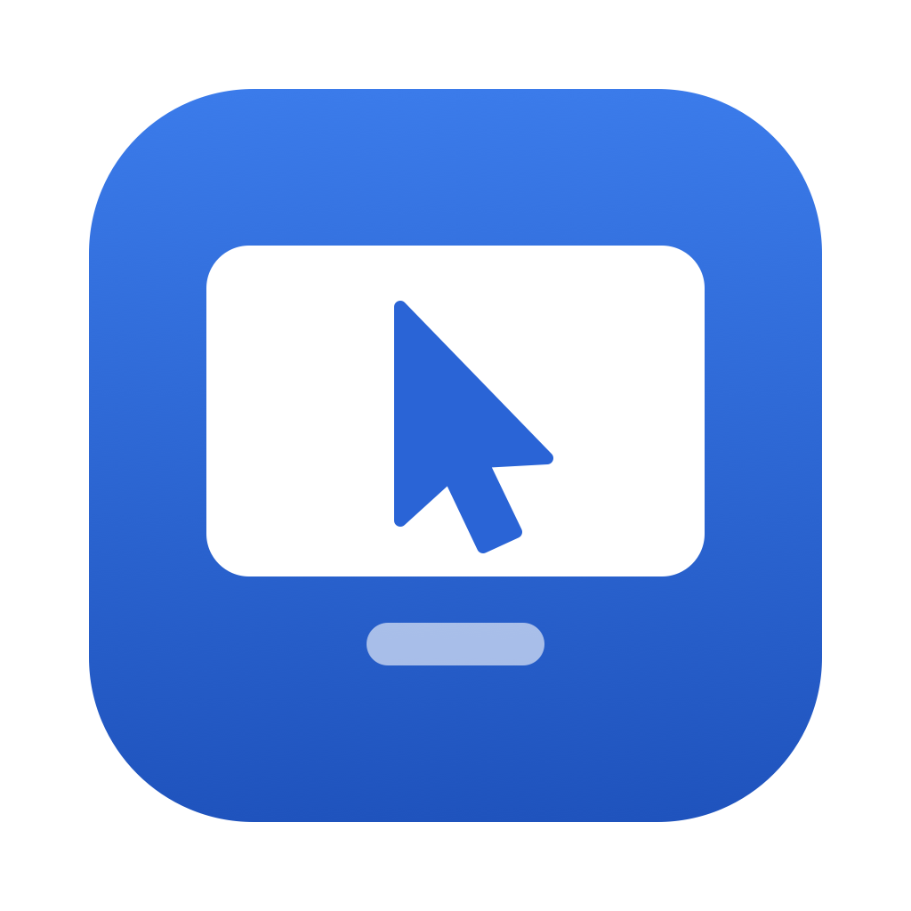
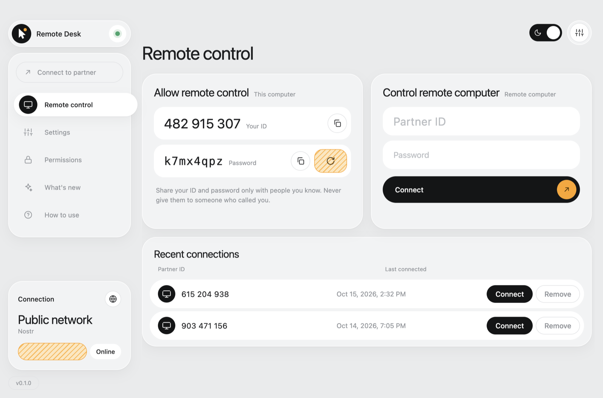
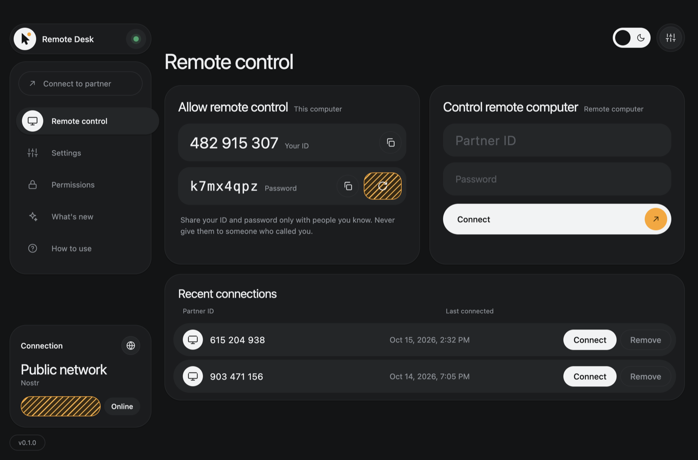
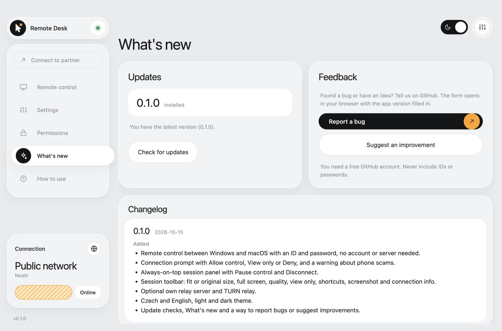

<p align="center"></p>

# Remote Desk

Open-source remote desktop for Windows and macOS. Install, share your ID and password, and let
someone control your computer — or control theirs. No account, no server to run.

> Early development. See [SECURITY.md](SECURITY.md) before using it on computers you care about.

https://github.com/user-attachments/assets/6e3cd5cc-f3c0-485e-bfc9-ae2eecc6329c

<p align="center">
  
</p>

<p align="center">
  
  
</p>

## Features

**Connecting**
- Control Windows and macOS computers, in both directions, at home or over the internet and mobile data.
- ID and password, or **favorites**: one click and no password, approved once at the other computer.
- Favorites also in the **menu bar / system tray** and the Mac **Dock**, and as
  `remotedesk://connect/<ID>` links for Shortcuts, Siri, Raycast, a Stream Deck or a desktop shortcut.
- **Reach your own computer while you are away**: starts at login, runs in the background and keeps
  the computer awake.

**During a session**
- Sharp picture: **1920 px at up to 60 fps**, dropping frames rather than sharpness on a slow network.
  Quality modes for smoothness, maximum sharpness or **saving mobile data**, with the real resolution
  and frame rate shown in the toolbar.
- The remote computer's **sound**, with a mute button.
- **Multiple monitors**: one at a time or all side by side.
- **Shared clipboard** (text) in both directions.
- **Files**: drag and drop onto the remote screen to send; copy a file there (Ctrl/Cmd+C) or pick it
  on the remote screen to download.
- **Privacy screen** (Windows): black out the controlled computer's monitors while you work on it.
- Shortcuts your own system would catch (Alt+Tab, Win, Cmd+Tab…), screenshots, full screen.

**Safety**
- Nobody gets in without **Allow** at the computer, except favorites that were approved there.
- An always-on-top session panel, local mouse priority, and approvals the remote side can't click for you.
- A history of every connection to this computer, with a notification when someone connects.
- No account; picture, sound and input go directly between the computers, encrypted.

**Everything else**
- Diagnostics log with IDs and keys redacted, ready to paste into a bug report.
- Automatic updates on Windows and macOS, Czech and English, light and dark theme.

## Install

Download the installer for your system from [Releases](../../releases):

- **Windows** — `Remote-Desk-…-win-x64.exe` (or `arm64`). Runs and installs in one click.
  The app is not code-signed yet, so Windows SmartScreen may warn: click **More info → Run anyway**.
- **macOS** — `Remote-Desk-…-mac-universal.dmg`. Drag the app to Applications.
  The app is not notarized yet, so on first launch macOS blocks it: open
  **System Settings → Privacy & Security** and click **Open Anyway**.

## Use

1. On the computer that should be controlled, open Remote Desk and send its **ID** and
   **password** to your partner.
2. Your partner enters them under **Control remote computer** and clicks **Connect**.
3. You click **Allow**. A black panel on top of all windows shows the session; **Disconnect** ends it any time.
4. For your own computers, click the **star** in the session toolbar. Once the other computer approves
   it, you connect with one click and no password.
5. To reach a computer while you are away (e.g. your home PC from school), turn on **Start at login
   and run in the background** and **Keep this computer awake** in its Settings.

On macOS the controlled Mac needs two permissions, granted once (the app guides you under
**Permissions**): **Screen Recording** and **Accessibility**. Windows needs no permissions.

Full user guide: [docs/guide.md](docs/guide.md) (also [in Czech](docs/navod.md)). A short version is also built
into the app under **How to use**.

## How it works

- Computers find each other through **public Nostr relays** (via [Trystero](https://github.com/dmotz/trystero)).
  The relays only pass the encrypted connection handshake; the password is the encryption key
  and never leaves your computer.
- Video and input then flow **directly** between the two computers over WebRTC (DTLS-SRTP encrypted).
- The screen is captured with Electron's `desktopCapturer`; mouse and keyboard are injected with
  [`@jitsi/robotjs`](https://github.com/jitsi/robotjs).

- Favorites use a second, private room per computer, encrypted with a key that computer hands to
  your device; your device also has to prove it holds its own private key.

Most connections are direct, mobile data included. Some networks (strict corporate or school
firewalls) block them; for those, add a TURN relay under **Settings → TURN relay** (e.g. your own
[coturn](https://github.com/coturn/coturn) or a hosted TURN service).

## Own server (optional)

Prefer not to depend on public relays? Run your own tiny relay and select
**Settings → Network → Own server** on **both** computers.

**On a home server or VPS with Docker:**

```bash
git clone https://github.com/Molyn597/remote-desk.git
cd remote-desk/server
docker build -t remote-desk-relay .
docker run -d --restart unless-stopped -p 8080:8080 remote-desk-relay
```

Use `ws://<server-ip>:8080` inside your local network.

**Over the internet with HTTPS** — point a domain at the server, then:

```bash
cd remote-desk/server
DOMAIN=relay.example.com docker compose up -d
```

Caddy obtains a certificate automatically. Use `wss://relay.example.com` in the app.

**Without Docker** (Node.js 24+): `npm install && npm run server`.

## Development

Requires Node.js 24+.

```bash
npm install
npm run app            # build and start the app
npm -w app run dist    # build installers into app/release
npm run server         # optional relay on ws://localhost:8080
```

Run a second instance on the same machine with its own profile:
`RD_USER_DATA=/tmp/rd-2 npm run app`.

## Releasing a new version

1. Describe the changes under a new `## [0.2.0] - date` heading in [CHANGELOG.md](CHANGELOG.md).
   The app shows this text in **What's new** and it becomes the release notes.
2. Set the new version (here `0.2.0`) and commit it:

   ```bash
   npm -w app version 0.2.0 --no-git-tag-version
   git commit -am "Release 0.2.0"
   ```

3. Tag and push:

   ```bash
   git tag v0.2.0
   git push origin main v0.2.0
   ```

GitHub Actions then checks that the tag matches the app version and has a changelog entry, builds the Windows installer and
the macOS DMG/ZIP, uploads them to a draft release and publishes it when all builds succeed.

Installed apps check for updates at start-up and every 4 hours, download the update in the
background and offer **Restart and update** on both Windows and macOS.

### macOS signing

Every macOS release is signed with the same self-signed certificate ("Remote Desk Signing"), so
macOS keeps Screen Recording and Accessibility permissions across updates and accepts in-place
updates. It is not an Apple Developer ID, so the very first install still needs
**System Settings → Privacy & Security → Open Anyway**.

The release workflow reads the certificate from two repository secrets:

- `MAC_CERT_P12_BASE64`: the certificate and private key (`.p12`), base64-encoded
- `MAC_CERT_PASSWORD`: its password

Keep a backup of the `.p12` and its password. Releases signed with a different certificate lose
permissions and can't update in place, so users would have to reinstall once.

## Feedback

Found a bug or have an idea? Use **What's new → Report a bug / Suggest an improvement** in the app,
or open an [issue](../../issues/new/choose). Security problems: see [SECURITY.md](SECURITY.md).

## Roadmap

- [x] Clipboard sync and file transfer
- [x] Multiple monitors
- [x] Favorites, unattended access while logged in, sound, privacy screen
- [ ] A Windows service for the sign-in screen and UAC prompts
- [ ] Images in the shared clipboard
- [ ] Code signing (Windows) and Apple notarization (macOS) to remove first-install warnings
- [ ] Signed update manifests (Ed25519) once electron-builder 27 is released

## License

[MIT](LICENSE)
